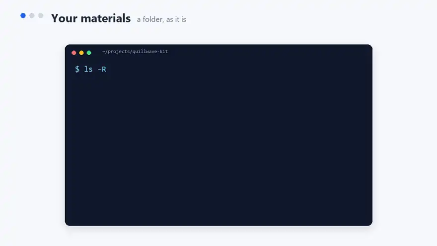
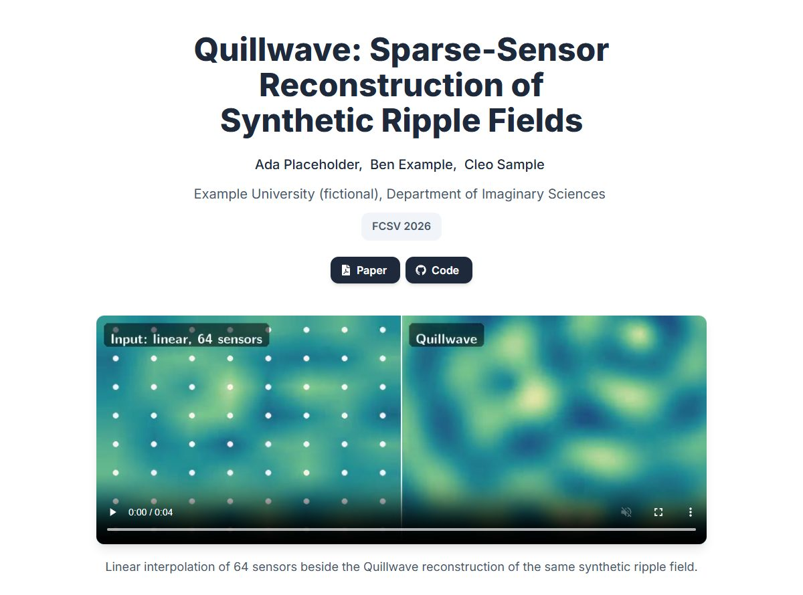
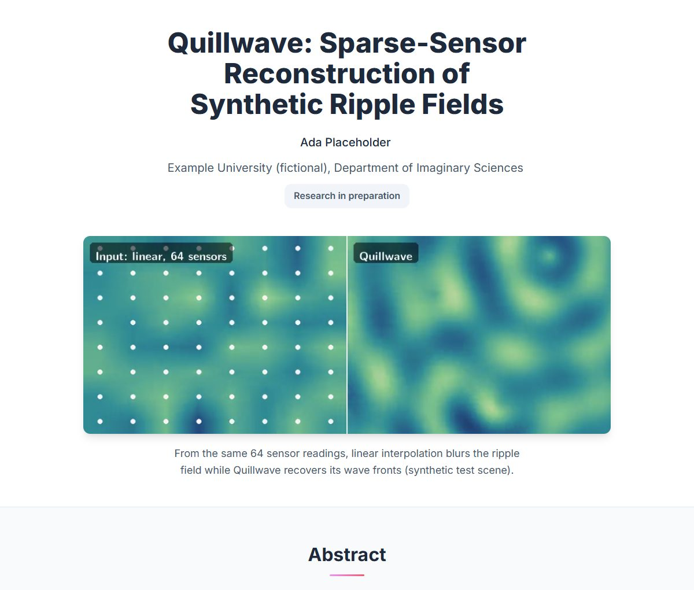
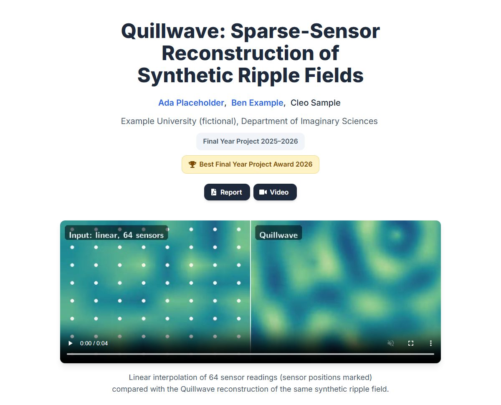

# Academic Project Page

**An agent skill that turns your paper, figures, and videos into a polished project page for GitHub Pages.**

Point your coding agent at a folder of project materials (a paper or report PDF, figures, result tables, videos, a poster, BibTeX) and it builds a responsive project page in the style of the [Academic Project Page Template](https://github.com/eliahuhorwitz/Academic-project-page-template) and [Nerfies](https://nerfies.github.io/). It then checks the page in a real browser before handing it back. The same skill also polishes an existing page or audits one before you publish.

[](https://github.com/royh1122/academic-project-page-skill/actions/workflows/validate-skill.yml)
[](https://agentskills.io)
[](#license)

**[Live demo](https://royh1122.github.io/academic-project-page-skill/)** · demos: [paper](https://royh1122.github.io/academic-project-page-skill/paper/), [in preparation](https://royh1122.github.io/academic-project-page-skill/in-preparation/), [final year project](https://royh1122.github.io/academic-project-page-skill/final-year-project/) · [Examples](#examples) · [Install](#quick-start)



The demo uses a fictional project, so nothing real is shown.

## Quick start

```bash
npx skills add royh1122/academic-project-page-skill
```

1. **Install** with the command above.
2. **Put your materials in a folder:** paper or report PDF, figures, tables, videos, poster, BibTeX.
3. **Ask with one prompt**, and say what only you know: authors, verified links and awards, what may be public.

A first prompt to try:

> Make a project page for our paper "…" by …, accepted at …. Paper: `<paper link>`, code: `<code link>`. The materials are in this folder. Put the page in `docs/`.

To polish or check an existing page:

> Our project page in `docs/` looks a bit off. Can you polish it? Don't change the content.

> Is the page in `docs/` ready to publish? Just tell me what's wrong.

In Claude Code you can also install it as a plugin (Claude Code 2.1.275 or later):

```
/plugin install academic-project-page --marketplace royh1122/academic-project-page-skill
```

In Codex, as a plugin:

```bash
codex plugin marketplace add royh1122/academic-project-page-skill
codex plugin add academic-project-page@royh1122-skills
```

Or copy the skill folder into your agent's skills directory by hand:

```bash
git clone https://github.com/royh1122/academic-project-page-skill.git
cp -r academic-project-page-skill/skills/academic-project-page ~/.claude/skills/
```

Tested with Claude Code and Codex. In Codex, the browser check needs your approval to run outside Codex's sandbox; Codex asks for it (see the FAQ). `npx skills add` also installs it for Cursor, Gemini CLI, GitHub Copilot and many other agents that read the `SKILL.md` format, but it has not been run in them yet. The browser checks need an agent that can run shell commands, plus the requirements below.

**Requirements:**

- Python 3 and Node 22 or newer
- an installed Chrome, Edge, or Chromium, for the browser checks
- ffmpeg, for converting GIFs and recordings

## Why not just the template?

The page builds on the [Academic Project Page Template](https://github.com/eliahuhorwitz/Academic-project-page-template) and [Nerfies](https://nerfies.github.io/). The skill adds what a template cannot do:

- **It does not invent.** Venues, awards, links, and metrics appear only when your sources verify them. A finalist is not an award; a target venue is not an acceptance.
- **It checks reused claims.** Caption text from a paper is compared with the data, and claims the data contradicts are dropped.
- **It keeps personal data off the page.** Names, IDs, and plates in raw files and video frames stay out.
- **It checks its own work in a real browser:** a page audit, an interaction check that drives zoom, carousels, menus, and the keyboard, a check of every number and every external link against your sources, and screenshots it opens and reads.

## What it does

**Build.** The agent reads the materials and fills the template with what they support: title, authors, venue or status line, resource buttons, teaser, abstract, method figure, results tables, carousels, an embedded poster, BibTeX with a copy button, and search and social metadata. Optional blocks the project lacks are removed, not left as placeholders.

**Content rules.** The page states only what the sources verify:

- A target venue or a finalist listing does not become an acceptance or an award.
- Draft numbers are not used.
- Every external link (paper, code, DOI, dataset, video) comes from your materials or your request.
- Claims in reused captions are checked against the data.
- Personal data, unreleased data, and harmful text stay off the page, including faces, badges, and plates in video frames.

**Media.**

- Short silent loops autoplay muted and stop for visitors who prefer reduced motion.
- Videos with audio get controls, captions, and a transcript.
- GIFs and anamorphic recordings are converted to square-pixel MP4.
- Dense figures open in an accessible zoom viewer.

**Checks.** Before reporting, the agent serves the page under its repository subpath, runs the browser audit and the interaction check, checks every number and external link against the source files, and reviews screenshots at 375, 768, and 1440 px. The audit covers missing files and placeholders, heading order, accessible names, contrast, fonts, overflow, alignment, letterboxed media, repeated images, video posters and seeking, reduced motion, and the theme's typography.

**Polish and Audit.** Polish fixes defects without changing content, stays inside the part you name, checks pasted reviewer notes on the live page before acting on them, and reports the audit before and after. Audit ranks problems from P0 (blocks publishing) to P3 (cosmetic), each with a way to fix it, and edits nothing.

**Honest reports.** Every report says which checks passed, which found problems, and which could not run, and why. A check that could not run is never reported as a pass.

## Examples

Each example was built in one run from a fictional project in the [evaluation kit](./eval-kit/), then compared with the same prompt given to an agent without the skill.

| Example | Materials |
| --- | --- |
| [Accepted paper](./examples/paper-full-links/README.md)<br><a href="./examples/paper-full-links/README.md"></a> | Paper and poster PDFs, captioned explainer video, comparison loops, figures, tables |
| [Research in preparation](./examples/research-in-preparation/README.md)<br><a href="./examples/research-in-preparation/README.md"></a> | Summary PDF, figures, tables, a draft submission plan, raw study data with personal details |
| [Final year project with an award](./examples/final-year-project-award/README.md)<br><a href="./examples/final-year-project-award/README.md"></a> | Report PDF, award letter, explainer video, private repositories, author pages |

## How it's tested

The [evaluation kit](./eval-kit/) is a fictional project with planted traps: an unverified award, a target venue that is not an acceptance, personal data in raw files, a caption claim the data contradicts, superseded numbers, and duplicate images. Fresh agents got the same prompt with and without the skill, and the results were checked by hand.

| Test | With the skill | Without |
| --- | --- | --- |
| Audit a page with 10 visual-only defects | 10 of 10 found | 5 of 10 |
| Polish that page | 9 fixed, the 10th flagged | 6 fixed, 1 flagged |
| Caption claim the data contradicts (earlier rounds) | removed in all 6 runs | kept in 2 of 5 runs |
| Video showing a person's name, ID, and licence plate | none published | one baseline published it |
| Zoomable figures per page | 8 to 9 | none |

These are small samples, one run per arm. They show what the skill catches, not how often. Details are in [eval-kit/README.md](./eval-kit/README.md).

## Built with this skill

No pages here yet. If you built or polished a public page you own with this skill, [add it](../../issues/new?template=showcase.yml). Only pages the submitter owns are listed.

## FAQ

**Does it publish anything?** No. Pages are built and previewed locally. The agent publishes, pushes, or changes repository visibility only when you ask.

**Does it need Chrome?** For the checks, yes: an installed Chrome, Edge, or Chromium. The skill installs nothing.

**Does it work offline?** Building and previewing do. The template's CSS and scripts are bundled, but the page requests the Inter font from Google Fonts (and Academicons from jsDelivr with the arXiv button); offline it falls back to system fonts. YouTube embeds contact YouTube. There are no analytics.

**Which agents?** Tested with Claude Code and Codex. In Codex the skill triggered on its own, asked to run the browser audit outside its sandbox, fixed what the audit found, and passed it once approved. Unattended Codex runs (`codex exec`) cannot ask, so there the browser check does not run unless you opt in (below). Other agents that read `SKILL.md` can install it, untested so far (see Quick start). Reports from other agents are welcome as issues.

**The audit says the browser tab never answered.** Your agent runs commands in its own sandbox, and Chrome could not start its own sandbox inside it (Codex's sandbox can do this). Approve the audit command when the agent asks to run it outside the sandbox, or run the audit yourself. If you run the agent unattended, you can set `PAGE_AUDIT_NO_SANDBOX=1`, which runs Chrome without its sandbox for these local checks; that is your call, and the agent never sets it.

**Can it restyle the page?** Yes. An explicit request wins over the default theme. A dark theme or a new accent colour is a `:root` token override with no layout change.

## What's inside

```text
skills/academic-project-page/
├── SKILL.md                    workflow: build, polish, or audit
├── references/
│   ├── layout-polish.md        layout rules and the pre-delivery checklist
│   ├── style-fidelity.md       theme: type scale, palette, spacing, components
│   └── theme-profile.json      expected rendered values for the typography check
├── template/index.html         page template with optional blocks
├── static/                     Bulma, Font Awesome, theme CSS, carousel, figure viewer, reduced-motion script
├── scripts/
│   ├── audit.mjs               browser audit and screenshots, using the installed Chrome
│   ├── preview_server.py       local preview under a repository subpath, with video seeking
│   ├── check_numbers.py        numbers on the page against the source files
│   ├── check_links.py          external links on the page against the source files
│   └── unused_assets.py        static files the page no longer uses
└── evals/evals.json            twelve evals
eval-kit/                       fictional projects, generator, and flawed-page fixtures for the evals
examples/                       example runs with screenshots
```

## License

- **Skill and tooling:** [MIT](./LICENSE).
- **Bundled template:** adapted from the [Academic Project Page Template](https://github.com/eliahuhorwitz/Academic-project-page-template) by Eliahu Horwitz and [Nerfies](https://github.com/nerfies/nerfies.github.io) by Keunhong Park et al., both [CC BY-SA 4.0](https://creativecommons.org/licenses/by-sa/4.0/). Generated pages keep the footer credit to both.
- **Evaluation kit:** [CC0](https://creativecommons.org/publicdomain/zero/1.0/).
