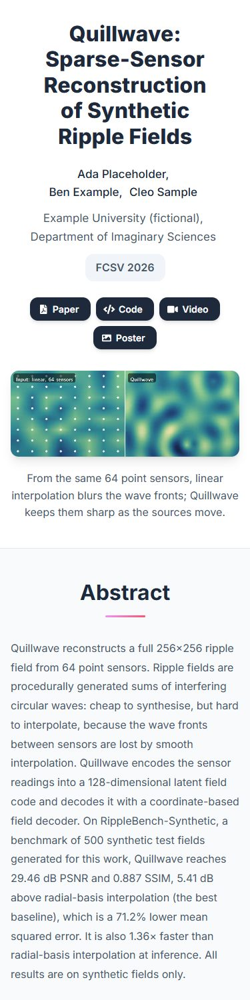
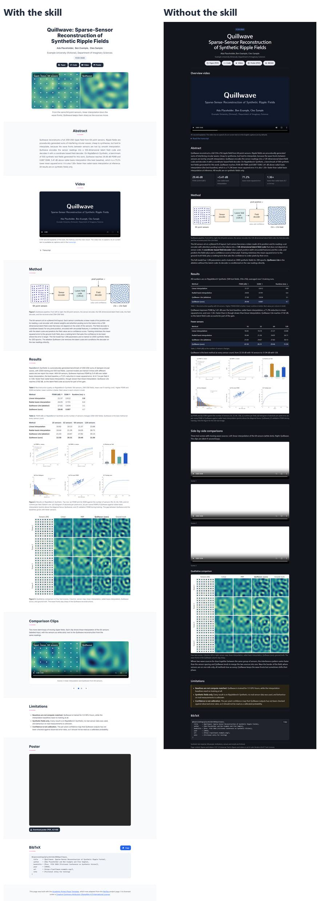

# Accepted paper with all links

**Materials:** kit [`eval-kit/kits/V1`](../../eval-kit/kits/V1) (fictional, generated). It contains:

- a paper PDF with its LaTeX source, and a poster PDF
- a captioned explainer video (it has an audio track), plus three silent comparison loops
- figures with captions, and result tables
- an acceptance e-mail, `links.json`, and `citation.bib`

**Prompt:**

> Make a project page for our paper "Quillwave: Sparse-Sensor Reconstruction of Synthetic Ripple Fields" by Ada Placeholder, Ben Example and Cleo Sample (Example University (fictional), Department of Imaginary Sciences), accepted at FCSV 2026. The materials are in this folder. Paper: https://quillwave.example.org/quillwave_fcsv2026.pdf, code: https://code.example.org/quillwave. Host the explainer video video/overview_explainer.mp4 with the page (no external video service). The comparison clips in results/loops are silent. Put the page in docs/.

Built in one run by a fresh agent with the skill. No edits afterwards.

## What the agent did

- **Header:** a venue line confirmed by the acceptance e-mail. Paper and Code buttons, plus Video and Poster buttons that jump to sections on the page.
- **Video:** the explainer has controls, `preload="none"`, captions and a transcript. The loops autoplay muted, with reduced motion respected.
- **PDF poster:** embedded with a download button, falling back to a link on phones. It flagged that the poster has a placeholder QR box.
- **Figures:** both dense figures are zoomable, with their empty margins cropped.

**Gate:** page audit and typography pass, with no warnings. A scripted check confirmed figure zoom, the carousel, video seeking (206 responses) and the copy button.

**What it missed:** it repeated a caption sentence that the data contradicts ("the gap grows with fewer sensors"). `check_numbers.py` compares values, not claims. This run led to a new rule in the skill: check reused captions' claims against the tables. The fictional kit now registers that sentence as trap T16.

## Compared with no skill

- **Invented address:** the baseline made up a hosting address for the page's link-preview tags.
- **Figures and layout:** metric tiles, figures that can't be enlarged, and loops without poster frames, which the audit warned about.
- **Video seeking:** never verified, because Python's simple server ignores range requests.

