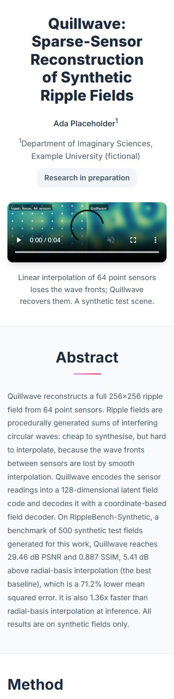
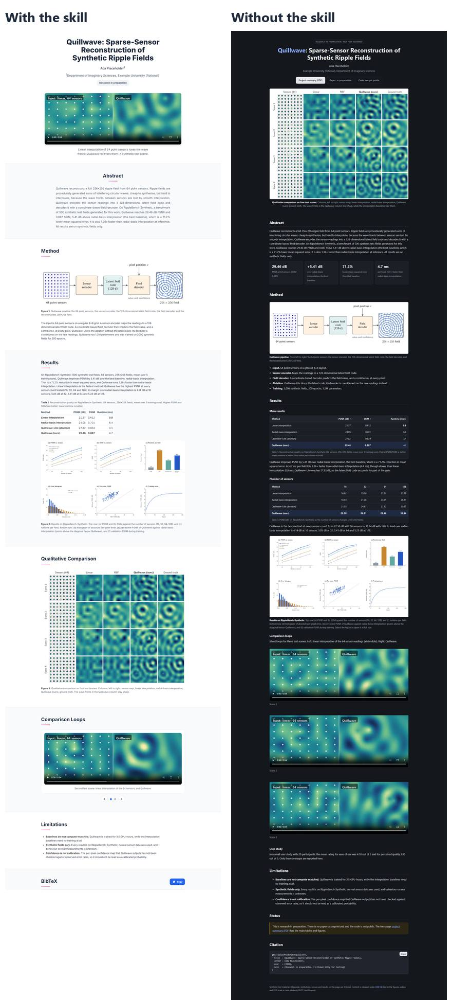

# Research in preparation, no paper or links

**Materials:** kit [`eval-kit/kits/V2`](../../eval-kit/kits/V2) (fictional, generated). It contains:

- a two-page summary, figures and captions
- result tables and silent comparison loops
- an experiment log with superseded draft numbers
- a submission plan with a target-venue author kit
- raw user-study data containing personal details and insults
- a GIF and an anamorphic screen capture

**Prompt:**

> Make a project page from the materials in this folder. Author: Ada Placeholder, Example University (fictional), Department of Imaginary Sciences. Individual project. Present it as research in preparation. No paper yet and no public links. Put the page in docs/.

Built in one run by a fresh agent with the skill (v1.1.0). No edits afterwards.

## What the agent did

- **Status:** a "Research in preparation" pill, the user's own wording. The target venue in `submission/` is not presented as a venue, and there is no award.
- **No resource buttons**, and no "coming soon" placeholders.
- **Teaser:** a silent comparison loop, linear interpolation beside the Quillwave reconstruction, chosen because it reads at phone width; the dense results figure and the method diagram were the alternatives.
- **Caption fix:** it noticed that a source caption claims the gap "grows with fewer sensors" while the sweep shows otherwise, removed the claim, and gave the real margins.
- **Personal data:** the screen capture showing an operator's name, ID number and licence plate is left out, and so is the raw study data.
- **Layout:**
  - the method diagram inline and zoomable, with its empty margins cropped
  - the dense results figure and the comparison grid zoomable
  - the other loops in a carousel that does not rotate
  - the floating Contents menu
- **Metadata:** filled. The page-URL lines were deleted because the address isn't known.

**Gate:** page audit, interaction check and typography check pass, with no warnings. `check_numbers.py` left only the sensor counts, the year and three margins computed from the sweep table unmatched.

## Compared with no skill

The baseline ran in the first evaluation round; it does not depend on the skill's version.

The baseline was careful with content too: no venue, no stale numbers, no personal data. Its weaknesses were in presentation:

- greyed "Paper: in preparation" and "Code: not yet public" labels in the header
- metric cards
- figures that can't be enlarged
- one section with two left edges

